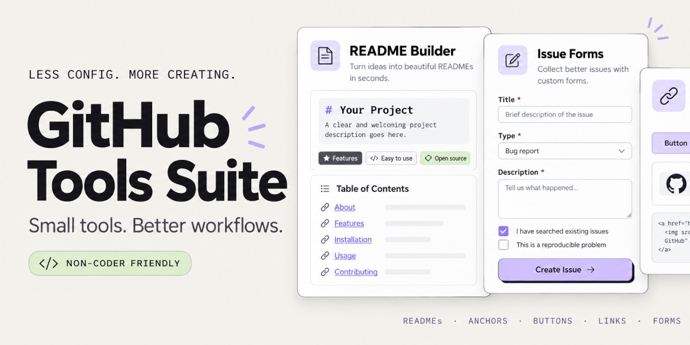

# Github Tools

   

> A collection of **[free tools](https://monapdx.github.io/Github-Tools/)** and utilities for enhancing **Github** repositories: **[markdown editor](https://monapdx.github.io/Github-Tools/github_dashboard_builder.html)** with *live preview* and templates to build a **README.md** for your project, generators to add **[image badges](https://monapdx.github.io/Github-Tools/github-button-generator.html)** and for creating customized **[Issue Templates](https://monapdx.github.io/Github-Tools/issue-template-generator.html)**.

## WHAT IS AN ISSUE TEMPLATE?

 For anyone who isn't from the developer community and is new to Github, you can think of an Issue as a form submission.

Someone has something to say about your project or repository and they want to bring it to your attention or get in touch with you/collaborate.

If they visit your repo and then attempt to submit a new Issue, they will arrive at a basic form that allows them to contact you. 

Rather than leaving the default form, you can completely design your own with customized questions, different inputs (even file or image uploads), and make crucial information required in order to successfully submit the form.

In fact, the coolest part is that you can create as many custom forms for visitors as you need or want! 

Let's say you created an Awesome List repo that features curated resources for a topic that you are passionate about.

You'd like to offer others a way to participate and suggest other resources that you can consider adding.

And, crucially, you also want a way for a visitor to report a dead link that is stale and should be removed from the list.

It's easy to make templates for both. Then when a visitor goes to submit a new Issue, they will be presented with two options: suggest a resource, or report a dead link.

They can click on the one they need, then it takes them to the form that collects all the necessary information for you to either add the new site or remove the unresponsive one.

Issue Template **[examples](https://github.com/monapdx/Github-Tools/tree/main/.github/ISSUE_TEMPLATE)**.

`https://github.com/USERNAME/REPO-NAME/.github/ISSUE_TEMPLATE/`

## ARE YOU NEW TO GITHUB?

 You don't have to be a developer or coder to use Github (I'm not either!)

But when you are not, the conventions of the platform can be rather confusing and there is certainly a learning curve.

Which is exactly why I started my blog **[Github for Non-Coders](https://monapdx.github.io/github-for-non-coders/blog/)**, where I publish posts to **[help beginners](https://monapdx.github.io/github-for-non-coders/blog/github-for-non-coders-tiny-skills-that-10x-what-you-can-do.html)** learn the basics and show them the many ways Github can be used beyond just storing code.

